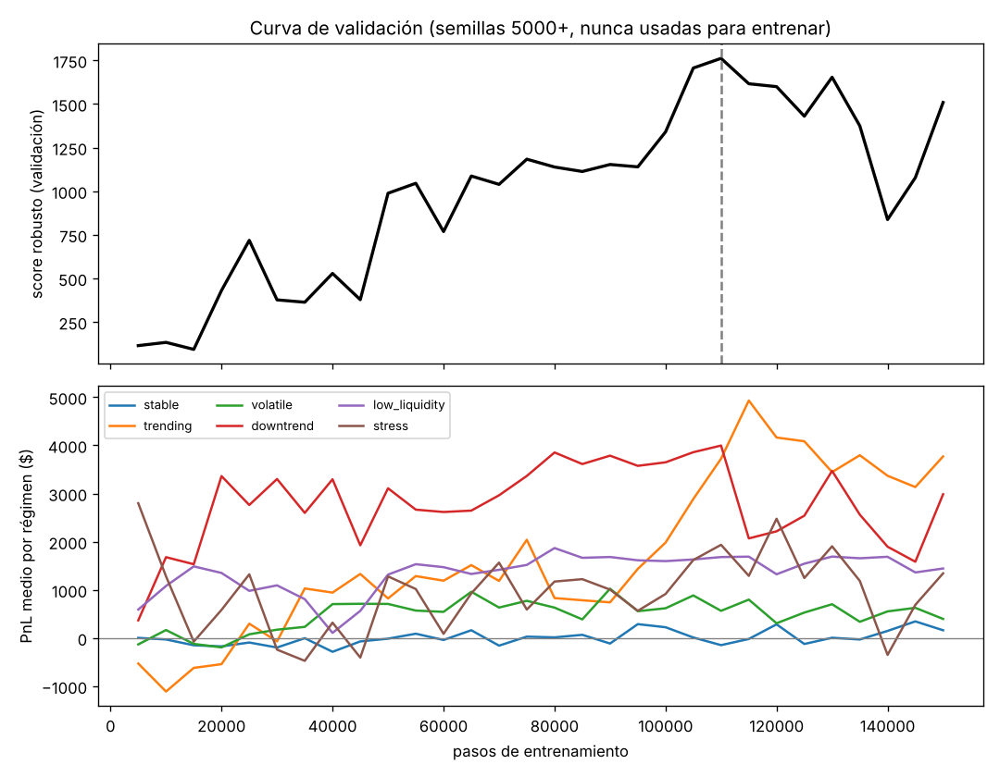

# Paso 8 · Mejoras al modelo y evidencia de que funcionan

La sección 11 del documento pide investigar al menos una mejora significativa **y evaluarla**. Hicimos
seis, cada una motivada por un problema concreto del DQN inicial (Paso 6), y luego las apagamos una por
una (ablación) para medir su aporte.

## Las mejoras (todas en `student_work/`)
| # | Mejora | Archivo | Problema que ataca |
|---|---|---|---|
| 1 | **Recompensa ajustada al riesgo** (media-varianza) + costo de liquidar al final | `envs.py` | El DQN inicial apostaba todo en una dirección: la recompensa casi no castigaba el riesgo. |
| 2 | **Regímenes aleatorios** (tendencias en ambos sentidos, baja liquidez, estrés y mercados con parámetros al azar) | `envs.py`, `train.py` | En práctica solo existe tendencia alcista → aprende "comprar siempre". |
| 3 | **Double DQN** | `train.py` | Sobreestimación de Q con recompensas muy ruidosas. |
| 4 | **Red dueling** (V(s) + A(s,a)) | `model.py` | La mayor parte del valor depende del estado, no de la acción. |
| 5 | **Retornos de 3 pasos** (n-step) | `train.py` | La señal de PnL es ruidosa y tarda en propagarse. |
| 6 | **Selección del checkpoint en validación** + actualización suave de la red target + 150k pasos | `train.py` | Con 5k pasos casi todo es exploración, y el último checkpoint no es necesariamente el mejor. |

### 1. La recompensa
```python
risk_std = abs(inv) * mid * volatilidad / 1000      # desviación del próximo dNAV por tener inventario
reward   = dNAV / 1000 - 0.5 * kappa * risk_std**2   # utilidad media-varianza
if done:
    reward -= abs(inv) * medio_spread / 1000         # costo de cerrar la posición
```
- Crece con el **cuadrado** de la posición: 50 acciones casi no se castigan, 500 sí.
- Crece con la **volatilidad**: la misma posición es más peligrosa en `volatile` que en `stable`.
- No castiga operar: las órdenes de mercado ya pagan el spread en el simulador.
- La recompensa solo existe al entrenar; el modelo exportado sigue siendo 16 → 9.

**Elegir κ (aversión al riesgo).** Entrenamos tres valores, evaluados en 10 semillas de validación
por régimen:

| κ | score robusto | PnL `volatile` | drawdown `stress` | drawdown medio (6 regímenes) |
|---|---:|---:|---:|---:|
| 0.01 | **1,729** | −323 (30 % ganadoras) | 4,043 | ~1,200 |
| **0.05** (elegido) | 1,567 | +647 (90 % ganadoras) | 1,201 | ~410 |
| 0.2 | 930 | +523 (90 % ganadoras) | 394 | ~180 |

Escogimos **κ = 0.05** aunque no tiene el score más alto: sacrifica ~10 % del score frente a κ = 0.01
pero **reduce el drawdown medio a un tercio** y deja de perder en `volatile`. Como el profesor usará
escenarios y semillas que no conocemos (ABIDES), preferimos el modelo menos expuesto a una sola
dirección del mercado. κ = 0.2 es casi un *market maker* puro: muy seguro, pero deja de aprovechar
tendencias.

### 2. Regímenes de entrenamiento
Cada episodio: 50 % un régimen con nombre (`stable`, `trending`, `volatile`, `downtrend`,
`low_liquidity`, `stress`) y 50 % un mercado aleatorio:
drift ∈ [−0.05 %, +0.05 %], volatilidad log-uniforme en [0.05 %, 0.5 %], spread ∈ [3, 40] pb,
profundidad ∈ [150, 1000], choques con probabilidad 0/2/5 %.

### 3–6. Algoritmo
```python
# Double DQN: la red online ELIGE, la red target EVALÚA
best_a = q(ns).argmax(dim=1, keepdim=True)
nxt    = target(ns).gather(1, best_a).squeeze(1)
y      = R_3pasos + gamma**3 * (1 - done) * nxt
# Target suave (Polyak)
target = (1 - 0.005) * target + 0.005 * q
```
Hiperparámetros finales: 150.000 pasos, γ = 0.99, n = 3, lr = 3e-4, lote 128, replay 100.000,
ε de 1.0 a 0.02 en el 50 % del entrenamiento, clipping 10, validación cada 5.000 pasos en 6 regímenes ×
4 semillas (5000+), guardando el mejor.

**Comando del modelo final:**
```bat
.venv\Scripts\python.exe -m student_work.train --risk-aversion 0.05 --seed 7 --out outputs\model.pt
```
(≈ 20 min en CPU de 1 hilo; el resto de opciones ya tienen el valor final por defecto.)

## Curva de entrenamiento


El score de validación sube hasta ~110k pasos y luego oscila: **por eso guardamos el mejor checkpoint
y no el último**. También se ve que el aprendizaje no es monótono por régimen: `trending` sube tarde
(~100k pasos), cuando el agente aprende a distinguir tendencia de ruido.

## Resultado final en TEST (semillas 9000+, nunca vistas, 20 por régimen)
| política | escenario | PnL medio $ | desv. $ | peor $ | % semillas ganadoras | drawdown medio $ | trades | inventario final abs |
|---|---|---:|---:|---:|---:|---:|---:|---:|
| **modelo final** | stable | 63 | 249 | -356 | 50% | 266 | 160 | 146 |
| **modelo final** | trending | 2,605 | 1,123 | 918 | 100% | 317 | 24 | 352 |
| **modelo final** | volatile | 354 | 401 | -340 | 70% | 392 | 134 | 27 |
| **modelo final** | downtrend | 3,544 | 685 | 2,475 | 100% | 281 | 185 | 317 |
| **modelo final** | low_liquidity | 1,637 | 166 | 1,357 | 100% | 115 | 165 | 30 |
| **modelo final** | stress | 1,276 | 1,098 | -869 | 85% | 1,269 | 124 | 100 |

| política | score robusto (test) |
|---|---:|
| **modelo final (Double Dueling DQN, κ=0.05)** | **1,360** |
| momentum (regla) | 707 |
| market maker (regla) | 547 |
| hold | 0 |
| DQN inicial | −256 |

Prueba oficial del paquete (`shared.test_policy`, semilla 101):
```
stable:   NAV=$100,345.81, PnL=$345.81, trades=162
trending: NAV=$100,572.88, PnL=$572.88, trades=40
volatile: NAV=$100,337.03, PnL=$337.03, trades=146
```
(El DQN inicial daba −1,162 / +2,913 / −5,282.)

**Lectura:**
- Positivo en **todos** los regímenes en promedio, y el peor caso de `volatile` pasa de −$4,296 a −$340.
- Aprendió un comportamiento mixto: en mercados laterales hace *market making* con órdenes límite
  (≈160 operaciones, inventario final bajo); en tendencias toma posición en la dirección correcta
  (pocas operaciones, inventario ~300–350), **en ambas direcciones** (el DQN inicial perdía en `downtrend`).
- Ojo con el sesgo de selección: en validación el score era 1,567 y en test 1,360. Escoger el mejor
  checkpoint mirando la validación la vuelve un poco optimista; por eso el reporte final usa test.

ABLATION_PLACEHOLDER

## Limitaciones y riesgos conocidos
- El mercado de práctica no tiene **impacto de mercado** ni competencia por la cola de órdenes límite;
  la ganancia por spread puede ser menor en ABIDES y en el torneo, donde otros agentes también cotizan.
- La probabilidad de ejecución de las órdenes límite es fija (55 %); en ABIDES depende del flujo real.
- `stable` sigue siendo el régimen más débil (50 % de semillas ganadoras): el agente a veces confunde
  ruido con tendencia y toma posición.
- Los regímenes "extra" están dentro de la distribución de entrenamiento; la prueba de verdad fuera de
  distribución es ABIDES.
